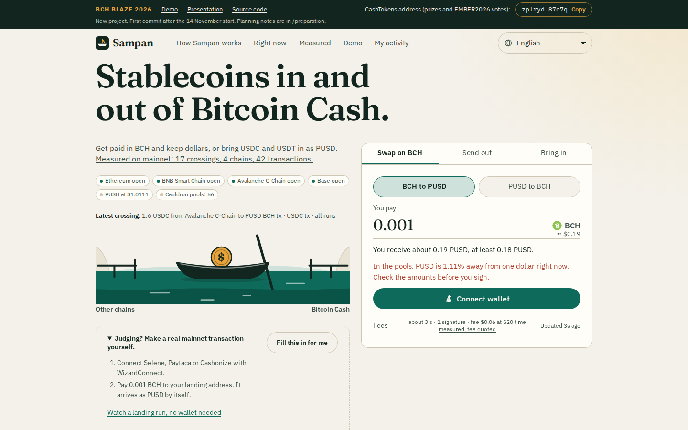
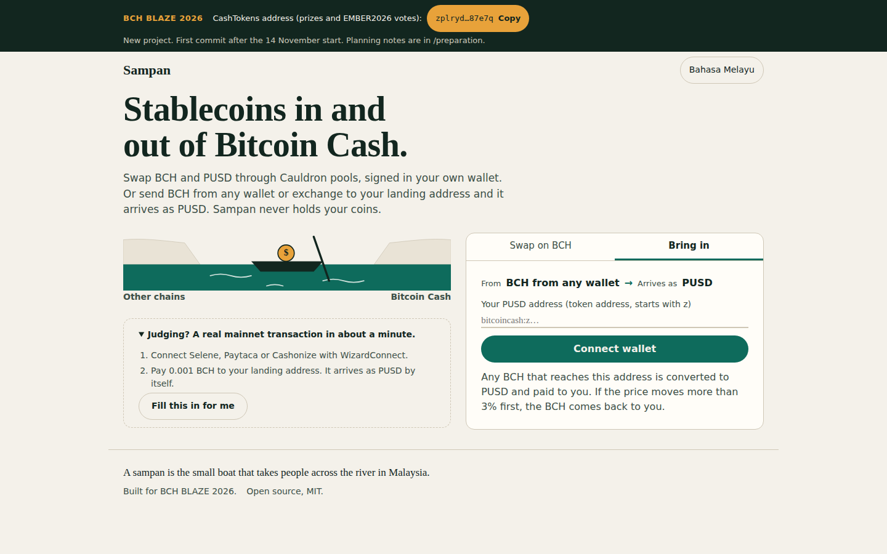
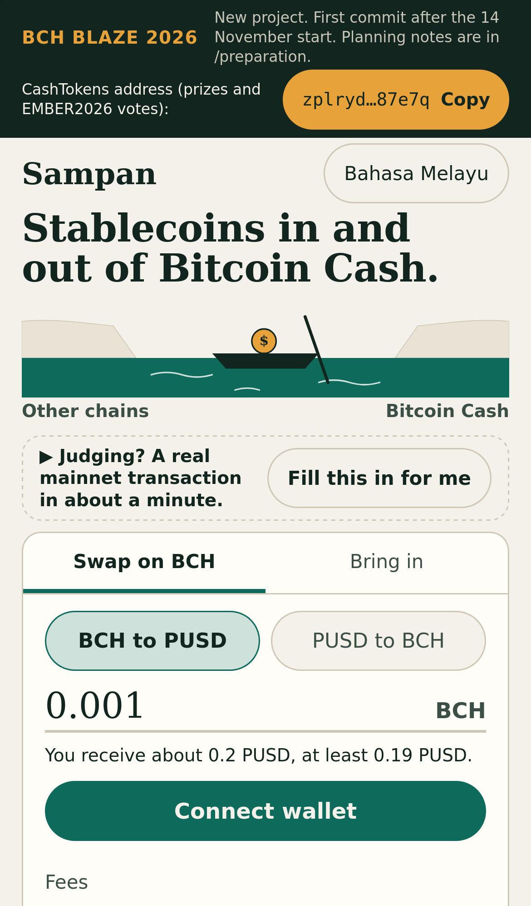

<p align="center"></p>

<h1 align="center">Sampan</h1>

<p align="center"><a href="LICENSE"></a> <a href="https://sampan.sasateguh.com"></a> <a href="#what-is-measured"></a></p>

<p align="center"><b>Dollar stablecoins in and out of Bitcoin Cash, signed in your own wallet.</b> · <i>Stablecoin dolar masuk dan keluar Bitcoin Cash, ditandatangani dalam dompet anda sendiri.</i><br>
<a href="https://sampan.sasateguh.com"><b>live demo</b></a> · <a href="#try-it-in-a-minute">Try it</a> · <a href="#run-it">Run it</a> · <a href="#what-is-measured">What is measured</a> · <a href="#limits">Limits</a> · <a href="README.ms.md">Bahasa Melayu</a><br>
Built in Malaysia by <a href="https://aimanmalib.com">Aiman Malib</a> · <a href="https://sasateguh.com">Sasa Teguh</a></p>

Sampan swaps BCH and the PUSD stablecoin through existing Cauldron pools on Bitcoin Cash mainnet, and gives you a landing
address: send BCH to it from any wallet and it arrives at your address as PUSD, while the Sampan server holds no key.

## Try it in a minute

The live site is [sampan.sasateguh.com](https://sampan.sasateguh.com). It runs on BCH mainnet with real coins, so keep the
amounts small.

1. Open the site and press **Connect wallet**. Scan the code or paste the link into a BCH wallet that speaks WizardConnect.
   Cashonize web and Selene web were checked against Sampan (see [Wallets checked](#wallets-checked)).
2. **Swap on BCH**: the form starts at 0.001 BCH to PUSD and shows the least you will receive. Press Swap, read the request in
   your wallet and approve it. The page shows the transaction and its explorer link when it is broadcast.
3. **Bring in**: enter or connect your token address (it starts with `z`), and the page shows a landing address made for you.
   Pay 0.001 BCH to it from any wallet. The BCH is converted to PUSD and paid to your address. The status page follows it.

On the front page, **Fill this in for me** opens the Bring in tab for step 3.

<p align="center"></p>

<p align="center"> </p>

## The problem and the answer

Dollar stablecoins exist on Bitcoin Cash as CashTokens, and PUSD trades in Cauldron pools. Getting into them is still work.
Someone holding BCH on an exchange has to withdraw to a wallet that understands tokens, find a pool, and trade. Someone who
wants to be paid in dollars on BCH has to ask the payer to do all of that for them, or do it again after every payment.

Sampan answers with two things you can use today. The swap tab trades BCH and PUSD in one transaction that your own wallet
signs, after the page has checked what the server built. The landing address is a small contract: whoever pays BCH to it,
from any wallet, the coins can leave towards one place, your address, either as PUSD at or above a minimum rate or,
after six blocks, as the BCH itself. You keep a recovery card, so you can finish or recover a landing without Sampan.

### What already exists

Checked on 16 November 2026, and BCH Bull on 17 November 2026 from its own home page and user guide.

- The Cauldron app has an X-chain tab that swaps plain BCH with other chains through THORChain. Its code does not send
  CashTokens to the cross-chain vault.
- Paytaca has Cash In, which gets you BCH by converting other coins through SideShift or by buying from peers.
- BCH Bull's own site describes hedging BCH against USD and other assets, or going long or short on BCH, with AnyHedge contracts
  funded in BCH, while Sampan trades BCH for PUSD, a token you then hold.

With Cauldron and Paytaca, getting to PUSD is a second swap.

## Business model

**Who it is for.** People in Southeast Asia who already hold USDT and want dollars on Bitcoin Cash, and people who are
paid in BCH and want part of it kept in dollars without setting up a token wallet beforehand. The
numbers below were read from public APIs on the day shown: BCH trades in volume, while the dollar liquidity on BCH
itself is small, so the step between the two is where Sampan sits.

**From an exchange, as tested once.** BCH was bought on Binance spot (BCH/USDT) from a USDT balance, in 5 steps and
about 2 minutes, then withdrawn straight to the Sampan test wallet: 0.098701 BCH in
[693c583b84893344133a448ee9f40c3133700dad372fe74ebdd0cc5de3c23548](https://blockchair.com/bitcoin-cash/transaction/693c583b84893344133a448ee9f40c3133700dad372fe74ebdd0cc5de3c23548),
in a block at 12:19 UTC on 15 November 2026. That withdrawal went to an ordinary address. An exchange paying a landing
address has not been tested.

**Where revenue would come from.** `business.feeBps` adds one output to `business.feeAddress` on each swap (measured
once at 30 bps on a local server, see the `fee 30 bps` row in [the measured runs](docs/MEASURED.md#runs)), and
`thorchain.affiliateBps` would take a share on the cross-chain route once a THORName is registered. A landing address
carries no fee; the contract does not change. Both settings are 0 during the event and live in `config/sampan.json`,
so changing them needs no code.

<!-- business-model:start (made by scripts/business-model.ts from config/sampan.json) -->
| Number | Value | Read on | Source |
| --- | --- | --- | --- |
| BCH traded across all markets in 24 hours | USD 61,029,720 per day | 2026-11-16 | https://api.coingecko.com/api/v3/coins/bitcoin-cash?localization=false&tickers=false&community_data=false&developer_data=false |
| Value locked in Cauldron pools on BCH | USD 991,821 | 2026-11-16 | https://api.llama.fi/protocol/cauldron |
| USDT in circulation on all chains | USD 175,325,413,949 | 2026-11-16 | https://stablecoins.llama.fi/stablecoins?includePrices=false |

Scenario, arithmetic, not a forecast. Base: BCH traded across all markets in 24 hours (USD 61,029,720 per day, read 2026-11-16) x share x a 30 bps fee. The Sampan fee today is 0 bps.

| Share of that volume through Sampan | Fee per day at 30 bps | Fee per year (365 days) |
| --- | --- | --- |
| 1 % | USD 1,831 | USD 668,275 |
| 5 % | USD 9,154 | USD 3,341,377 |
| 10 % | USD 18,309 | USD 6,682,754 |
<!-- business-model:end -->

### Sampan Pay

For merchants who want to be paid in BCH and keep dollars. Each invoice gets its own landing address from the same
contract (only a nonce in the rate differs), priced in USD and paid in BCH from any wallet that can send to a P2SH
address; exchange withdrawals not tested. The BCH becomes PUSD at the merchant's address, or after six blocks goes
back to the merchant as BCH. Sampan does not hold it. A signed webhook (Standard Webhooks) reports the result.

```
POST /api/pay/invoice      {"usd": 12.5, "merchantAddress": "bitcoincash:z...", "webhookUrl": "https://...", "webhookSecret": "whsec_..."}
GET  /api/pay/invoice/:id  status: open, paid, underpaid, overpaid, paid_late or expired
webhook events             invoice.paid, invoice.underpaid, invoice.overpaid, invoice.paid_late
```

Button: `<script src="https://sampan.sasateguh.com/pay.js" defer></script>` and `<button data-sampan-invoice="<id>">`
([example](https://sampan.sasateguh.com/pay/example.html)). A short payment is `underpaid` and only what it covers
is converted; a payment after the invoice expires is `paid_late`. The webhook waits for the conversion to be on the
network.

Revenue: `pay.spreadBps` asks the payer that much more BCH. The merchant still gets exactly the invoice in PUSD, and
the rest goes to `business.feeAddress` through one input and output pair the finisher adds; the contract does not
change ([ADR 0031](docs/decisions/0031-sampan-pay-spread.md)). It needs a key for that small fee coin, so the public
site runs at 0. Measured once on a local server at 50 bps: the merchant got 0.20 PUSD and 1331 sats reached the fee
address, a test wallet address (the `spread 50 bps` row in [the measured runs](docs/MEASURED.md#runs)).

<!-- pay-model:start (made by scripts/business-model.ts from config/sampan.json) -->
Scenario, arithmetic, not a forecast. Base: BCH traded across all markets in 24 hours (USD 61,029,720 per day, read 2026-11-16) x share x a 50 bps spread. The spread today is 0 bps.

| Share of that volume paid through Sampan Pay | Spread per day at 50 bps | Spread per year (365 days) |
| --- | --- | --- |
| 1 % | USD 3,051 | USD 1,113,792 |
| 5 % | USD 15,257 | USD 5,568,962 |
| 10 % | USD 30,515 | USD 11,137,924 |

| Public price of a crypto payment gateway | Value | Read on | Source |
| --- | --- | --- | --- |
| BitPay crypto acceptance fee, under USD 500,000 a month | 2 % + USD 0.25 per transaction | 2026-11-16 | https://www.bitpay.com/pricing |
<!-- pay-model:end -->

## How it works

1. **Connect.** The page pairs with your wallet over WizardConnect (`web/src/wallet/wizard.ts`). The wallet shares extended
   public keys; the page derives your addresses itself and the server scans them through public Electrum servers.
2. **Quote and build.** The server reads the Cauldron pools from the public indexer, rebuilds each pool's locking bytecode from
   its owner hash to confirm the pool on chain, and builds an unsigned transaction (`core/pools`, `server/swap.ts`).
3. **Check in the browser.** Before any wallet sees it, `core/check.ts` compares the transaction with what the page showed: your
   own outputs, the rebuilt pool locks, the amount leaving your wallet, the fee cap and the minimum you receive. A transaction
   that adds an output for someone else or lowers the minimum is refused (`tests/client-swap.test.ts`).
4. **Sign and send.** The wallet shows its own summary and signs. The server broadcasts and waits until the Electrum index
   lists the new outputs, so your balance is right on the next screen.
5. **Landing.** For Bring in, the server computes a landing address from your address and the current rate minus a
   tolerance; the page computes the same address again from the same terms and refuses to show one that differs. A finisher
   converts what arrives through the pools, or returns it after six blocks.

## The landing contract

[`contracts/landing.cash`](contracts/landing.cash) is 37 lines of CashScript 0.14. A landing address is a P2SH20 address
of that contract with five parameters: the owner's locking bytecode, the token category, a minimum rate as two integers, and
the number of blocks after which the BCH may be returned.

- `convert`: output 0 must pay the owner, carry the token category, and hold at least `rateNum / rateDen` token units
  per satoshi received. There must be as many outputs as inputs, so nothing extra can be paid out.
- `giveBack`: once the coin is `returnAfter` blocks old (6 in [`config/sampan.json`](config/sampan.json)), it can be sent back to
  the owner as plain BCH, less at most 1000 satoshis of fee.
- No key of the service appears in the contract. Anyone may run either path, and both pay the owner.

To check a landing yourself: `npm run verify-landing -- <card.json>` compiles the source with `cashc`, derives the address
with CashScript and compares it with the recovery card. Decisions and tests: [ADR 0008](docs/decisions/0008-landing-contract.md),
`contracts/landing.test.ts`.

### Anyone can run the finisher

For a landing, Sampan's server is optional. The status page gives a recovery card (a small JSON file), and from a clean clone
of this repository one command finishes the landing from it:

```bash
npm ci && npm run finisher -- card.json
```

The finisher ([`scripts/finisher-cli.ts`](scripts/finisher-cli.ts)) reads the coins at the landing address from the public
Electrum servers and the pools from the public Cauldron indexer listed in [`config/sampan.json`](config/sampan.json), and
nothing else: it never calls the Sampan site or its API (`tests/finisher-cli.test.ts` checks this). It converts when the pools
meet the contract minimum, otherwise it gives the BCH back once the coin is old enough. `--dry-run` builds and checks the
transaction without sending it; `--help` lists the options. The giveBack row
[`5671fd92`](https://explorer.salemkode.com/tx/5671fd920b3a3c74d322b23250d31a33326452e28528236227f0c89f3a585ba6) in the table
below was made this way. Swaps and crossings still need the server, for the quote and to build the transaction.

## What is measured

Every row is a mainnet transaction from [`docs/MEASURED.md`](docs/MEASURED.md), written by the scripts in `tools/measure/`
against the real page in Chromium, except the rows made on the owner's phone, which were found afterwards by address history
and not timed. Seconds run from pressing Swap to the page showing the broadcast, or for landings from the payment to the
conversion. Failed rows stay in the table.

| UTC (2026) | flow | amount | signed by | seconds | result | transaction |
|---|---|---|---|---|---|---|
| 11-15 12:38 | swap | 0.001 BCH to at least 0.19 PUSD | Sampan test wallet | 1.4 | ok | [`3ab8f28d`](https://explorer.salemkode.com/tx/3ab8f28d873185c1206eb558d31692d2aa2d3ac22d10813ef9cb03d016af6f26) |
| 11-15 12:51 | swap | 0.001 BCH to at least 0.19 PUSD | Sampan test wallet | 2.6 | ok | [`a7dc452a`](https://explorer.salemkode.com/tx/a7dc452a9225a43f6d8565a6560cf0e19d79f0cd38a354f6d2006afc4287605e) |
| 11-15 12:51 | swap | 0.4 PUSD to at least 0.00188825 BCH | Sampan test wallet | 0.8 | fail: wallet did not sign, nothing sent | - |
| 11-15 12:52 | swap | 0.001 BCH to at least 0.19 PUSD | Sampan test wallet | 3.4 | ok | [`4178ec6e`](https://explorer.salemkode.com/tx/4178ec6e73e9babe0932a1efd3fb249e505ccd135e63af2e47cf6143e82ddbeb) |
| 11-15 12:52 | swap | 0.6 PUSD to at least 0.00283237 BCH | Sampan test wallet | 1.4 | fail: wallet did not sign, nothing sent | - |
| 11-15 12:53 | swap | 0.001 BCH to at least 0.19 PUSD | Sampan test wallet | 3.5 | ok | [`18f728af`](https://explorer.salemkode.com/tx/18f728af257d3a9f90a8b91ab61a05a4a7d219bf5bb5dbc3722f52150e59d98b) |
| 11-15 12:53 | swap | 0.8 PUSD to at least 0.00377648 BCH | Sampan test wallet | 2.9 | ok | [`f2ba7ddd`](https://explorer.salemkode.com/tx/f2ba7ddd2712927e339d7294ef1d95ad4814245896643380bb2ed14fc82359be) |
| 11-15 12:53 | swap | 0.001 BCH to at least 0.19 PUSD | Sampan test wallet | 1.9 | ok | [`c5a9641d`](https://explorer.salemkode.com/tx/c5a9641d388051aeedccc918e27d7a71e25b880e36f8ea68380a280f19eed14d) |
| 11-15 12:53 | swap | 0.2 PUSD to at least 0.00094412 BCH | Sampan test wallet | 1.9 | ok | [`348a19cf`](https://explorer.salemkode.com/tx/348a19cf7c15fb1751cb76746539db2bee6cce3091f84dd99066c9b94419e064) |
| 11-15 12:53 | swap | 0.001 BCH to at least 0.19 PUSD | Sampan test wallet | 3.0 | ok | [`796c730d`](https://explorer.salemkode.com/tx/796c730ded97cf41ee144c60270bde7a70adc4fd84ce4999ef600af5124c04a4) |
| 11-15 12:55 | swap | 0.001 BCH to at least 0.19 PUSD | Sampan test wallet | 2.4 | ok | [`cc419c61`](https://explorer.salemkode.com/tx/cc419c612d7ae9474c8e1b33585a5dcc55d968db2f6e83ecee3d95aecc154da2) |
| 11-15 12:55 | swap | 0.4 PUSD to at least 0.00188821 BCH | Sampan test wallet | 2.9 | ok | [`35b4f68d`](https://explorer.salemkode.com/tx/35b4f68d212b93df1089951cd998115dbf708a046b323a0b3b479c27911c92d4) |
| 11-15 12:55 | swap | 0.001 BCH to at least 0.19 PUSD | Sampan test wallet | 2.9 | ok | [`11ab321b`](https://explorer.salemkode.com/tx/11ab321b49204daad4187444e07b1d0e000fdc8281cfcfa68716f83fda7575fe) |
| 11-15 12:56 | swap | 0.2 PUSD to at least 0.00094411 BCH | Sampan test wallet | 2.9 | ok | [`dd1b6c41`](https://explorer.salemkode.com/tx/dd1b6c416a19acb5371674cdd5ba179d00067d625c2d1f30751d9a8771adb2df) |
| 11-15 13:15 | swap | 0.001 BCH to at least 0.19 PUSD | Cashonize web | - | ok | [`b05c33b3`](https://explorer.salemkode.com/tx/b05c33b32fc4aacd371325b8fb9c73b7067ef030c20b3b5d4d6d84adcd221a50) |
| 11-15 13:16 | swap | 0.2 PUSD to at least 0.00094423 BCH | Cashonize web | 2.8 | ok | [`26f9aab0`](https://explorer.salemkode.com/tx/26f9aab0dc21774ab687e0f3a9ceb04fd3d03d7b0501e73190064c44eecc4398) |
| 11-15 19:24 | land | 0.001 BCH to 0.20 PUSD | paid through WizardConnect | 1.0 | ok | [`3c04bd0a`](https://explorer.salemkode.com/tx/3c04bd0a95e8432b0f36cbead20cc8aff32b017e2f88951ed7766cd02d251a79) |
| 11-15 19:25 | land | 0.001 BCH to 0.20 PUSD | plain payment | 4.0 | ok | [`418fe0c9`](https://explorer.salemkode.com/tx/418fe0c9d58fcb671e9d5cda5fd40c081be9f9496a114a59142048fa19375b6d) |
| 11-15 19:25 | land | 0.001 BCH to 0.20 PUSD | plain payment | 3.0 | ok | [`f75dbaca`](https://explorer.salemkode.com/tx/f75dbacac674f8d835e69d245ccb8100181bea8f1ec5bd4cafb6e2901de2c7fe) |
| 11-15 20:13 | giveBack | 0.003 BCH back to the owner after 6 blocks | public finisher, no Sampan server | 2800.4 | ok | [`5671fd92`](https://explorer.salemkode.com/tx/5671fd920b3a3c74d322b23250d31a33326452e28528236227f0c89f3a585ba6) |
| 11-15 21:44 | swap | 0.001 BCH to at least 0.19 PUSD | Selene web | 4.1 | ok | [`f9c4f0f3`](https://explorer.salemkode.com/tx/f9c4f0f3ce552d5f4e70c0500968d26791904fe22fe5e2d5b452a17215844e44) |
| 11-15 21:44 | swap | 0.2 PUSD to at least 0.00095011 BCH | Selene web | 3.9 | ok | [`600b815b`](https://explorer.salemkode.com/tx/600b815b45d36066daadbf8f42b75ea16a5eeb03ba2eeba5e711afbcfa38e389) |
| 11-16 06:42 | swap | 0.00096309 BCH to 0.20 PUSD | Paytaca iOS, owner's phone | - | ok | [`4c83412e`](https://explorer.salemkode.com/tx/4c83412e895794fd079d5f77b131fb320a464f58e17effd0c13563d022d57bfb) |
| 11-16 06:42 | land | 0.001 BCH to 0.20 PUSD | Paytaca iOS, owner's phone | - | ok | [`069a3f83`](https://explorer.salemkode.com/tx/069a3f838227e4efcc4952466347582284b1924eba347ebaaaf00da494743e2f) |
| 11-16 06:42 | swap | 0.40 PUSD to 0.00191467 BCH | Paytaca iOS, owner's phone | - | ok | [`3e528db3`](https://explorer.salemkode.com/tx/3e528db3e6fd4a65b713cde806e5ae444caa15f69c1fcc34ee79305dbebff19f) |
| 11-16 06:51 | swap | 0.00096309 BCH to 0.20 PUSD | Selene iOS, owner's phone | - | ok | [`fdac791d`](https://explorer.salemkode.com/tx/fdac791db778ff37640e7741a8578b30db95b0b963bd1b45ff5eeab271720944) |

In numbers: 19 swaps broadcast in both directions, 16 of them timed from 1.4 to 4.1 seconds; 4 landings converted to PUSD at
the owner, 3 of them timed with a median of 3.0 seconds from payment to conversion; 1 giveBack by the public finisher after it refused a conversion below the
card's minimum rate; 2 sells refused by the test wallet's own check. The cause of those two was a bug in the test wallet's
policy, fixed with a regression test; nothing was sent. The same file lists three Cauldron pools whose locks were rebuilt from
`owner_pkh` and found on chain.

### Crossings

Every crossing between BCH and another chain in [`docs/MEASURED.md`](docs/MEASURED.md#runs), made by
`scripts/crossings-table.ts`, failed runs included. Seconds run from the first signature to the arrival on the other chain
(for Bring in, to the conversion at the landing address). Each leg links to its explorer: the BCH transaction, the
stablecoin transaction on the other chain, the conversion to PUSD for Bring in, and the THORChain trace of the deposit.

<!-- crossings:start (made by scripts/crossings-table.ts from docs/MEASURED.md) -->
| UTC (2026) | route | direction | asset | sent | seconds | result | transactions |
|---|---|---|---|---|---|---|---|
| 11-17 12:03 | THORChain | BCH → Ethereum | USDC | 1.8 PUSD | 373.7 | ok | [`bch 80a72627`](https://blockchair.com/bitcoin-cash/transaction/80a72627cdc8f8155b3b1b9ea4d47d6500f82481c060ec9a372407bfb3acbf84) · [`eth 0xe88f9a52`](https://etherscan.io/tx/0xe88f9a5286c592755250428ce4ca3acffd18f4cfd4b65f406e30edf6eb2a27f0) · [THORChain](https://thorchain.net/tx/80a72627cdc8f8155b3b1b9ea4d47d6500f82481c060ec9a372407bfb3acbf84) |
| 11-17 12:10 | THORChain | BCH → Ethereum | USDC | 1.8 PUSD | 1104.0 | ok | [`bch fa3bdc53`](https://blockchair.com/bitcoin-cash/transaction/fa3bdc53bf3a3d7ce25dc4f2c6fbc0c262c238141b5300fad07f720737c0f577) · [`eth 0xfb1f69e1`](https://etherscan.io/tx/0xfb1f69e1c1a4c6e33940a65cde16df19fb2510428604ec948657942137751e86) · [THORChain](https://thorchain.net/tx/fa3bdc53bf3a3d7ce25dc4f2c6fbc0c262c238141b5300fad07f720737c0f577) |
| 11-18 03:20 | THORChain | BCH → Ethereum | USDC | 0.014 BCH | 466.6 | ok | [`bch c803bfef`](https://blockchair.com/bitcoin-cash/transaction/c803bfef5923eb065de8857580f0b90ac338509d3ca0249dd41a80e9c7d76fd0) · [`eth 0xaad48e53`](https://etherscan.io/tx/0xaad48e53acc8e94f88d3395abc05afd811f6882a7103498a161b16b7ae981d47) · [THORChain](https://thorchain.net/tx/c803bfef5923eb065de8857580f0b90ac338509d3ca0249dd41a80e9c7d76fd0) |
| 11-18 03:28 | THORChain | Ethereum → BCH | USDC | 1.8 USDC | 219.0 | ok | [`bch 93f6c6a5`](https://blockchair.com/bitcoin-cash/transaction/93f6c6a533cb817d59b78ed0ce5046292003e6ad5c09405fdfb6c75fe9d3f201) · [`eth 0xbe6a17f1`](https://etherscan.io/tx/0xbe6a17f1e2ba17b3039f825c7aceeb1ed3fc036fdef1d6822acf03cae42714ff) · [`convert 6d073bd8`](https://blockchair.com/bitcoin-cash/transaction/6d073bd8897b8774f0857b29f797dfdc03cd694e6c00507b7b9ba0115dd06683) · [THORChain](https://thorchain.net/tx/be6a17f1e2ba17b3039f825c7aceeb1ed3fc036fdef1d6822acf03cae42714ff) |
| 11-18 03:32 | THORChain | Ethereum → BCH | USDC | 1.8 USDC | 94.8 | ok | [`bch ee698449`](https://blockchair.com/bitcoin-cash/transaction/ee69844983f8798eebcf5640745a9ad382f7e223bc060c7c0cfd7d172921fea8) · [`eth 0xb240ea2b`](https://etherscan.io/tx/0xb240ea2b86daaa3f21a5165482be7a05c7289db91c03bb28ce455f9c17406b37) · [`convert 1549b330`](https://blockchair.com/bitcoin-cash/transaction/1549b3302e0a6185e95d1a4fdc2421426f62268cefa9a47e6bb5a2062d6ad484) · [THORChain](https://thorchain.net/tx/b240ea2b86daaa3f21a5165482be7a05c7289db91c03bb28ce455f9c17406b37) |
<!-- crossings:end -->

### Wallets checked

| Wallet | How | Result |
|---|---|---|
| Sampan test wallet (`@wizardconnect/wallet` 0.2.4, headless) | mainnet, paired through the page | 12 swaps broadcast |
| Cashonize web (cashonize.com) | fresh wallet in automated Chromium | paired, showed the page's prompt and the balance change, signed both directions |
| Selene web (app.selene.cash, 2026.10.02) | fresh wallet in automated Chromium, against the live site | paired, showed the prompt, the net change and every output, signed both directions |
| Paytaca on iPhone (owner's phone) | live site in the phone browser; the page's button only offers Copy link, so the link was pasted in the wallet | paired, swapped both directions, paid a landing address that converted to PUSD |
| Selene on iPhone (owner's phone) | same, link pasted in the wallet | stayed on "Waiting for your wallet" once, paired on the second try, swapped BCH to PUSD |

### Tests

Depot CI run `08cj526tf5` on 16 November 2026, commit `f93ceb9`, ran `scripts/gerbang-ujian.sh`: lint, type checks,
256 unit tests in 40 files (vitest), the build, and 36 browser tests (Playwright, Chromium desktop and WebKit iPhone 13)
against the built server with fake providers. All passed. The unit tests include a server that adds a stranger's output or lowers the minimum, and a landing card that
does not match its own address; both are refused before any wallet is asked to sign.

## Judging criteria and track rules

| Criterion or rule | Where to look |
|---|---|
| Innovation and creativity | The landing address ([The landing contract](#the-landing-contract)): a payer needs no token wallet and no Sampan account |
| Design and usability | The live site in English and Malay, laid out for phones; the judging steps sit on the opening screen ([its e2e test](e2e/first-screen.spec.ts)) |
| Technical strength | Browser check before signing (`core/check.ts`), the contract and its tests, [What is measured](#what-is-measured) |
| Business potential | [Business model](#business-model): users, sourced numbers, the fee settings (0 during the event) and a scenario table made from config |
| Mainnet Track: live demo in one click | [sampan.sasateguh.com](https://sampan.sasateguh.com), a 0.001 BCH swap or landing on mainnet |
| Mainnet Track: WizardConnect | `web/src/wallet/wizard.ts`, the pairing dialog in `web/src/wallet/` |
| Mainnet Track: banner on the home page | `web/src/Banner.tsx`: event name, CashTokens address with a copy button, the planning note |
| Mainnet Track: open source repository | [MIT licence](LICENSE), this repository |

## Limits

- **Cross-chain covers what was measured.** Send out and Bring in run through THORChain only for the assets marked `live` in
  `thorchain.assets` ([`config/sampan.json`](config/sampan.json)), and an asset is marked only after two measured crossings
  in that direction ([Crossings](#crossings)). When THORChain halts a chain, the
  page shows the route as paused instead of offering it.
- **MUSD is off** (`features.musd` is `false`). PUSD is the one token offered.
- **Small amounts.** A swap is at most 250 USD and the BCH side at least 50000 satoshis; the same minimum applies to a
  landing (`limits` in config).
- **Rates move.** A landing converts when the pools pay at least its minimum rate, set when the address is made. If the price
  moves more than the tolerance before that, the BCH comes back after six blocks instead.
- **Wallets.** Two web wallets and the headless test wallet were checked. Mobile wallet apps were not measured.
- **Not measured here:** use by people other than the builder, the size of the market, and any revenue. The route fee setting
  (`thorchain.affiliateBps`) is 0.

## Run it

Node 22 and npm. From a clean clone, one command builds and starts the server with fake providers (no network, no coins):

```bash
npm ci && npm run build && SAMPAN_FAKE=1 npm start
```

Open `http://localhost:8080`; `curl http://localhost:8080/healthz` answers `{"ok":true}`. Set `PORT` to use another port.
This was checked on 16 November 2026 from `git archive HEAD` in an empty folder. Without `SAMPAN_FAKE=1` the server talks to
mainnet Electrum servers and the Cauldron indexer listed in the config. `npm test` runs the unit tests and
`bash scripts/gerbang-ujian.sh` runs the whole gate.

## Use Sampan from an AI agent

[`mcp/`](mcp/) is a small Model Context Protocol server over stdio, a thin client of the public Sampan API. It holds no
private key and never signs: your wallet signs. Its tools:

- `quote_swap`: price a BCH and stablecoin swap in the Cauldron pools (read only).
- `create_landing_address`: open a landing address for an owner. The server sends the recovery card; the MCP server recomputes
  the address from the card with [`core/landing.ts`](core/landing.ts), the same check the page runs, and refuses it when it
  differs or pays someone else. It returns the address, the status page link and the card.
- `get_crossing_status`: what the status page shows for an id (read only).
- `create_invoice`: a Sampan Pay invoice, listed only when the site has Sampan Pay on.

After `npm ci` in a clone, add it to an MCP client. In a project `.mcp.json`:

```json
{
  "mcpServers": {
    "sampan": { "command": "npm", "args": ["--prefix", "/path/to/sampan", "run", "--silent", "mcp"] }
  }
}
```

or with Claude Code: `claude mcp add sampan -- npm --prefix /path/to/sampan run --silent mcp`. Set `SAMPAN_URL` to use
another Sampan server (default: `site.url` in the config). [`mcp/tools.test.ts`](mcp/tools.test.ts) starts it with this
command from another folder and talks to it through the MCP SDK client; it also checks that a landing address that does not
match its card is refused. On the live site, `quote_swap`, `create_landing_address` and `get_crossing_status` were
tested with the MCP SDK client, and `quote_swap` was tested with Claude Code (`claude -p` with only that tool allowed); see
[AI agent](docs/MEASURED.md#ai-agent). The MCP SDK and `zod` are development dependencies, so the production image does not carry them.

## Architecture

- `core/` pure TypeScript: pool math, transaction builders, the browser check, the landing address. No I/O.
- `contracts/` the landing contract, its compiled artifact and tests.
- `server/` Fastify API, Electrum and indexer clients, SQLite (`node:sqlite`), the landing finisher. It never holds a private key.
- `web/` Vite and React page; all text comes from `lang/en.json` and `lang/ms.json`.
- `config/sampan.json` holds every value that may change: limits, servers, timings, flags.
- `mcp/` the MCP server for AI agents (no keys, no signing).
- `tools/` measuring scripts and the headless test wallet; `docs/decisions/` records each design decision.

More in [`AGENTS.md`](AGENTS.md).

## Third-party

| Package | Licence | Used for |
|---|---|---|
| `@wizardconnect/core`, `dapp`, `react`, `wallet` | LGPL-3.0 ([upstream LICENSE.txt](https://gitlab.com/riftenlabs/lib/wizardconnect/-/blob/master/LICENSE.txt)) | wallet pairing and signing requests |
| `cashscript`, `cashc` | MIT | the landing contract |
| `@bitauth/libauth` | MIT | transactions, addresses, VM checks |
| `@noble/curves`, `@scure/base` | MIT | Schnorr signatures, key recovery and bech32 for identity checks (behind a flag) |
| `@cashlab/cauldron`, `@cashlab/common` | ISC | Cauldron pool arithmetic, cross-checked in tests |
| `@electrum-cash/network` | MIT | Electrum client |
| `fastify`, `@fastify/static` | MIT | server |
| `react`, `react-dom` | MIT | page |
| `viem` | MIT | EVM wallet code (behind the cross-chain flag) |
| `@walletconnect/ethereum-provider` 2.21.8 | Apache-2.0 (later releases use a vendor licence and are not used) | WalletConnect for EVM wallets, loaded only when picked |
| `qrcode-generator` | MIT | QR codes |
| `@modelcontextprotocol/sdk`, `zod` | MIT | the MCP server (development only) |
| `@playwright/test`, `typescript` | Apache-2.0 | browser tests, types |

Services used at run time: public Electrum (Fulcrum) servers, the Cauldron indexer, the WizardConnect relays named in the
config, and, when a WalletConnect project id is set, the WalletConnect relay and its Verify service. Sampan is not affiliated with any of them.

## Built for BCH BLAZE 2026 (Mainnet Track), 14 to 22 November 2026

This is a new project. The repository opened with commit `596b0e5` at 2026-11-14 15:40 UTC, after the build start. The plan
written before any code is in [`preparation/PLAN.md`](preparation/PLAN.md), and each step since is one line in
[`docs/BUILD-LOG.md`](docs/BUILD-LOG.md).

## AI disclosure

The research, design and code in this repository were produced with Claude Code under my direction. I registered for the
event, did the roll call, and funded the mainnet test wallet myself.

## Disclaimer

Sampan is a hackathon build that moves real coins on BCH mainnet. Use small amounts. PUSD (ParyonUSD) is a third-party token;
Sampan does not issue it and cannot vouch for its value. Nothing here is financial advice.

## License

MIT. See [`LICENSE`](LICENSE).

## Work with Sasa Teguh

I built this project. I run [Sasa Teguh](https://sasateguh.com), a studio in Malaysia that builds websites found on Google and in AI answers, and sets up systems like this one for businesses.

[Book a call](https://sasateguh.com/book) · hello@sasateguh.com · [More from Sasa Teguh](https://github.com/sasateguh)
