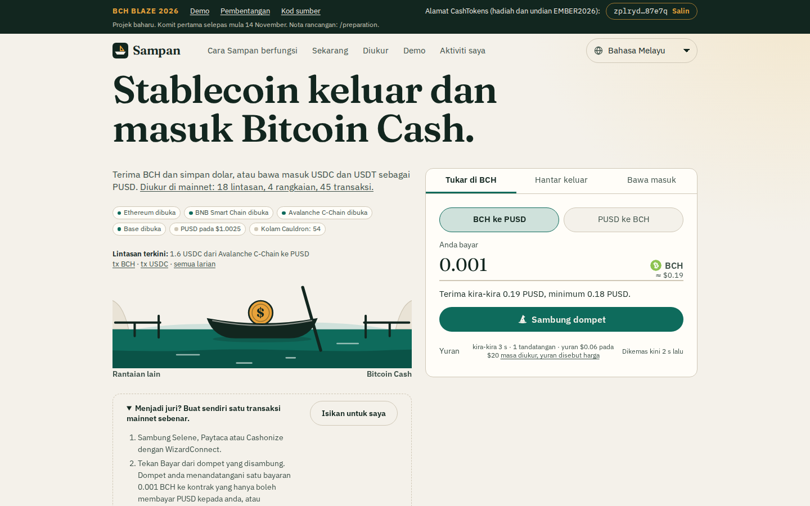
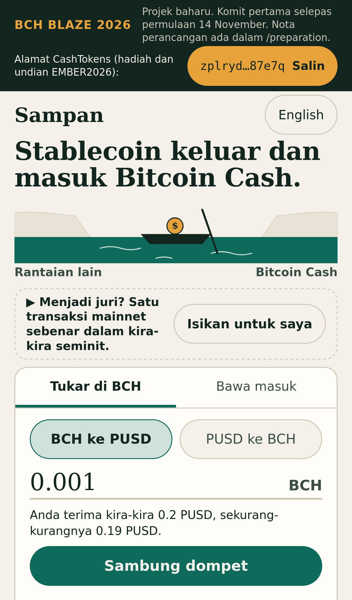

<p align="center"></p>

<h1 align="center">Sampan</h1>

<p align="center"><a href="LICENSE"></a> <a href="https://sampan.sasateguh.com"></a> <a href="#apa-yang-diukur"></a></p>

<p align="center"><b>Stablecoin dolar masuk dan keluar Bitcoin Cash, ditandatangani dalam dompet anda sendiri.</b> · <i>Dollar stablecoins in and out of Bitcoin Cash, signed in your own wallet.</i><br>
<a href="https://sampan.sasateguh.com"><b>demo hidup</b></a> · <a href="#cuba-dalam-seminit">Cuba</a> · <a href="#jalankan-sendiri">Jalankan</a> · <a href="#apa-yang-diukur">Apa yang diukur</a> · <a href="#had">Had</a> · <a href="README.md">English</a><br>
Dibina di Malaysia oleh <a href="https://aimanmalib.com">Aiman Malib</a> · <a href="https://sasateguh.com">Sasa Teguh</a></p>

Ini terjemahan Bahasa Melayu bagi [README.md](README.md). Jika kedua-duanya berbeza, versi Inggeris yang terpakai.

Sampan menukar BCH dan stablecoin PUSD melalui kolam Cauldron sedia ada di mainnet Bitcoin Cash, dan memberi anda alamat
pendaratan: hantar BCH ke alamat itu dari mana-mana dompet atau bursa, dan ia sampai ke alamat anda sebagai PUSD, sementara
pelayan Sampan tidak memegang sebarang kunci.

## Cuba dalam seminit

Laman hidup ialah [sampan.sasateguh.com](https://sampan.sasateguh.com). Ia berjalan di mainnet BCH dengan syiling sebenar,
jadi gunakan amaun yang kecil.

1. Buka laman dan tekan **Sambung dompet**. Imbas kod atau tampal pautan ke dalam dompet BCH yang menyokong WizardConnect.
   Cashonize web dan Selene web telah diuji dengan Sampan (lihat [Dompet yang diuji](#dompet-yang-diuji)).
2. **Tukar di BCH**: borang bermula dengan 0.001 BCH kepada PUSD dan menunjukkan jumlah paling sedikit yang anda terima. Tekan
   Tukar, baca permintaan dalam dompet anda dan luluskannya. Laman menunjukkan transaksi itu dan pautan penjelajahnya sebaik
   ia disiarkan.
3. **Bawa masuk**: masukkan atau sambungkan alamat token anda (bermula dengan `z`), dan laman menunjukkan alamat pendaratan
   yang dibuat untuk anda. Bayar 0.001 BCH ke alamat itu dari mana-mana dompet. BCH itu ditukar kepada PUSD dan dibayar ke
   alamat anda. Halaman status mengikutinya.

Di halaman utama, **Isikan untuk saya** membuka tab Bawa masuk untuk langkah 3.

<p align="center"> </p>

## Masalah dan jawapannya

Stablecoin dolar wujud di Bitcoin Cash sebagai CashTokens, dan PUSD didagangkan dalam kolam Cauldron. Untuk masuk ke dalamnya
masih memerlukan usaha. Pemegang BCH di bursa perlu mengeluarkannya ke dompet yang memahami token, mencari kolam, dan
berdagang. Sesiapa yang mahu dibayar dalam dolar di BCH perlu meminta pembayar melakukan semua itu, atau melakukannya sendiri
selepas setiap bayaran.

Sampan menjawab dengan dua perkara yang boleh digunakan hari ini. Tab tukar memperdagangkan BCH dan PUSD dalam satu transaksi
yang ditandatangani oleh dompet anda sendiri, selepas laman menyemak apa yang dibina oleh pelayan. Alamat pendaratan ialah
kontrak kecil: sesiapa pun yang membayar BCH kepadanya, dari mana-mana dompet atau bursa, syiling itu hanya boleh keluar ke
satu tempat, iaitu alamat anda, sama ada sebagai PUSD pada kadar minimum atau lebih tinggi, atau selepas enam blok sebagai BCH
itu sendiri. Anda menyimpan kad pemulihan, jadi anda boleh menyelesaikan atau memulihkan pendaratan tanpa Sampan.

### Apa yang sudah ada

Disemak pada 16 November 2026, dan BCH Bull pada 17 November 2026 daripada halaman utama dan panduan penggunanya sendiri.

- Aplikasi Cauldron ada tab X-chain yang menukar BCH biasa dengan rantaian lain melalui THORChain. Kodnya tidak menghantar
  CashTokens ke peti simpanan rentas rantaian.
- Paytaca ada Cash In, yang memberi anda BCH dengan menukar syiling lain melalui SideShift atau dengan membeli daripada orang lain.
- Laman BCH Bull sendiri menerangkan lindung nilai BCH berbanding USD dan aset lain, atau mengambil kedudukan long atau short ke atas BCH, dengan kontrak
  AnyHedge yang dibiayai dalam BCH, manakala Sampan menukar BCH kepada PUSD, token yang kemudian anda pegang.

Dengan Cauldron dan Paytaca, sampai ke PUSD ialah tukaran kedua.

## Cara ia berfungsi

1. **Sambung.** Laman berpasangan dengan dompet anda melalui WizardConnect (`web/src/wallet/wizard.ts`). Dompet berkongsi
   kunci awam lanjutan; laman menerbitkan alamat anda sendiri dan pelayan mengimbasnya melalui pelayan Electrum awam.
2. **Sebut harga dan bina.** Pelayan membaca kolam Cauldron dari pengindeks awam, membina semula bytecode penguncian setiap kolam
   dari hash pemiliknya untuk mengesahkan kolam itu di rantaian, dan membina transaksi yang belum ditandatangani (`core/pools`,
   `server/swap.ts`).
3. **Semak dalam pelayar.** Sebelum dompet melihatnya, `core/check.ts` membandingkan transaksi itu dengan apa yang laman
   tunjukkan: output anda sendiri, kunci kolam yang dibina semula, amaun yang keluar dari dompet, had yuran dan jumlah minimum
   yang anda terima. Transaksi yang menambah output untuk orang lain atau merendahkan minimum ditolak
   (`tests/client-swap.test.ts`).
4. **Tandatangan dan hantar.** Dompet menunjukkan ringkasannya sendiri dan menandatangani. Pelayan menyiarkannya dan menunggu
   sehingga indeks Electrum menyenaraikan output baharu, supaya baki anda betul pada skrin seterusnya.
5. **Pendaratan.** Untuk Bawa masuk, pelayan mengira alamat pendaratan dari alamat anda dan kadar semasa ditolak toleransi;
   laman mengira alamat yang sama sekali lagi dari terma yang sama dan menolak alamat yang berbeza. Penyelesai menukar apa yang
   sampai melalui kolam, atau memulangkannya selepas enam blok.

## Kontrak pendaratan

[`contracts/landing.cash`](contracts/landing.cash) ialah 37 baris CashScript 0.14. Alamat pendaratan ialah alamat P2SH20
kontrak itu dengan lima parameter: bytecode penguncian pemilik, kategori token, kadar minimum sebagai dua integer, dan
bilangan blok sebelum BCH boleh dipulangkan.

- `convert`: output 0 mesti membayar pemilik, membawa kategori token, dan memegang sekurang-kurangnya `rateNum / rateDen`
  unit token bagi setiap satoshi yang diterima. Bilangan output mesti sama dengan bilangan input, jadi tiada bayaran tambahan
  boleh keluar.
- `giveBack`: apabila syiling sudah berusia `returnAfter` blok (6 dalam [`config/sampan.json`](config/sampan.json)), ia boleh
  dihantar kembali kepada pemilik sebagai BCH biasa, ditolak yuran paling banyak 1000 satoshi.
- Tiada kunci perkhidmatan dalam kontrak. Sesiapa pun boleh menjalankan mana-mana laluan, dan kedua-duanya membayar pemilik.

Untuk menyemak pendaratan sendiri: `npm run verify-landing -- <card.json>` menyusun sumber dengan `cashc`, menerbitkan alamat
dengan CashScript dan membandingkannya dengan kad pemulihan. Keputusan dan ujian: [ADR 0008](docs/decisions/0008-landing-contract.md),
`contracts/landing.test.ts`.

### Sesiapa sahaja boleh menjalankan penyelesai

Untuk pendaratan, pelayan Sampan adalah pilihan. Halaman status memberi kad pemulihan (fail JSON kecil), dan dari klon bersih
repositori ini satu arahan menyelesaikan pendaratan daripadanya:

```bash
npm ci && npm run finisher -- card.json
```

Penyelesai ([`scripts/finisher-cli.ts`](scripts/finisher-cli.ts)) membaca syiling di alamat pendaratan dari pelayan Electrum
awam dan kolam dari pengindeks Cauldron awam yang disenaraikan dalam [`config/sampan.json`](config/sampan.json), dan tiada yang
lain: ia tidak pernah memanggil laman Sampan atau APInya (`tests/finisher-cli.test.ts` menyemak perkara ini). Ia menukar apabila
kolam memenuhi minimum kontrak, jika tidak ia memulangkan BCH apabila syiling sudah cukup usia. `--dry-run` membina dan menyemak
transaksi tanpa menghantarnya; `--help` menyenaraikan pilihan. Baris giveBack
[`5671fd92`](https://explorer.salemkode.com/tx/5671fd920b3a3c74d322b23250d31a33326452e28528236227f0c89f3a585ba6) dalam jadual
di bawah dibuat dengan cara ini. Tukaran dan lintasan masih memerlukan pelayan, untuk sebut harga dan membina transaksi.

## Apa yang diukur

Setiap baris ialah transaksi mainnet dari [`docs/MEASURED.md`](docs/MEASURED.md), ditulis oleh skrip dalam `tools/measure/`
terhadap laman sebenar dalam Chromium. Saat dikira dari tekan Tukar hingga laman menunjukkan transaksi disiarkan, atau bagi
pendaratan dari bayaran hingga penukaran. Baris yang gagal kekal dalam jadual.

| UTC (2026) | aliran | amaun | ditandatangani oleh | saat | keputusan | transaksi |
|---|---|---|---|---|---|---|
| 11-15 12:38 | swap | 0.001 BCH kepada sekurang-kurangnya 0.19 PUSD | dompet ujian Sampan | 1.4 | ok | [`3ab8f28d`](https://explorer.salemkode.com/tx/3ab8f28d873185c1206eb558d31692d2aa2d3ac22d10813ef9cb03d016af6f26) |
| 11-15 12:51 | swap | 0.001 BCH kepada sekurang-kurangnya 0.19 PUSD | dompet ujian Sampan | 2.6 | ok | [`a7dc452a`](https://explorer.salemkode.com/tx/a7dc452a9225a43f6d8565a6560cf0e19d79f0cd38a354f6d2006afc4287605e) |
| 11-15 12:51 | swap | 0.4 PUSD kepada sekurang-kurangnya 0.00188825 BCH | dompet ujian Sampan | 0.8 | gagal: dompet tidak menandatangani, tiada apa dihantar | - |
| 11-15 12:52 | swap | 0.001 BCH kepada sekurang-kurangnya 0.19 PUSD | dompet ujian Sampan | 3.4 | ok | [`4178ec6e`](https://explorer.salemkode.com/tx/4178ec6e73e9babe0932a1efd3fb249e505ccd135e63af2e47cf6143e82ddbeb) |
| 11-15 12:52 | swap | 0.6 PUSD kepada sekurang-kurangnya 0.00283237 BCH | dompet ujian Sampan | 1.4 | gagal: dompet tidak menandatangani, tiada apa dihantar | - |
| 11-15 12:53 | swap | 0.001 BCH kepada sekurang-kurangnya 0.19 PUSD | dompet ujian Sampan | 3.5 | ok | [`18f728af`](https://explorer.salemkode.com/tx/18f728af257d3a9f90a8b91ab61a05a4a7d219bf5bb5dbc3722f52150e59d98b) |
| 11-15 12:53 | swap | 0.8 PUSD kepada sekurang-kurangnya 0.00377648 BCH | dompet ujian Sampan | 2.9 | ok | [`f2ba7ddd`](https://explorer.salemkode.com/tx/f2ba7ddd2712927e339d7294ef1d95ad4814245896643380bb2ed14fc82359be) |
| 11-15 12:53 | swap | 0.001 BCH kepada sekurang-kurangnya 0.19 PUSD | dompet ujian Sampan | 1.9 | ok | [`c5a9641d`](https://explorer.salemkode.com/tx/c5a9641d388051aeedccc918e27d7a71e25b880e36f8ea68380a280f19eed14d) |
| 11-15 12:53 | swap | 0.2 PUSD kepada sekurang-kurangnya 0.00094412 BCH | dompet ujian Sampan | 1.9 | ok | [`348a19cf`](https://explorer.salemkode.com/tx/348a19cf7c15fb1751cb76746539db2bee6cce3091f84dd99066c9b94419e064) |
| 11-15 12:53 | swap | 0.001 BCH kepada sekurang-kurangnya 0.19 PUSD | dompet ujian Sampan | 3.0 | ok | [`796c730d`](https://explorer.salemkode.com/tx/796c730ded97cf41ee144c60270bde7a70adc4fd84ce4999ef600af5124c04a4) |
| 11-15 12:55 | swap | 0.001 BCH kepada sekurang-kurangnya 0.19 PUSD | dompet ujian Sampan | 2.4 | ok | [`cc419c61`](https://explorer.salemkode.com/tx/cc419c612d7ae9474c8e1b33585a5dcc55d968db2f6e83ecee3d95aecc154da2) |
| 11-15 12:55 | swap | 0.4 PUSD kepada sekurang-kurangnya 0.00188821 BCH | dompet ujian Sampan | 2.9 | ok | [`35b4f68d`](https://explorer.salemkode.com/tx/35b4f68d212b93df1089951cd998115dbf708a046b323a0b3b479c27911c92d4) |
| 11-15 12:55 | swap | 0.001 BCH kepada sekurang-kurangnya 0.19 PUSD | dompet ujian Sampan | 2.9 | ok | [`11ab321b`](https://explorer.salemkode.com/tx/11ab321b49204daad4187444e07b1d0e000fdc8281cfcfa68716f83fda7575fe) |
| 11-15 12:56 | swap | 0.2 PUSD kepada sekurang-kurangnya 0.00094411 BCH | dompet ujian Sampan | 2.9 | ok | [`dd1b6c41`](https://explorer.salemkode.com/tx/dd1b6c416a19acb5371674cdd5ba179d00067d625c2d1f30751d9a8771adb2df) |
| 11-15 13:15 | swap | 0.001 BCH kepada sekurang-kurangnya 0.19 PUSD | Cashonize web | - | ok | [`b05c33b3`](https://explorer.salemkode.com/tx/b05c33b32fc4aacd371325b8fb9c73b7067ef030c20b3b5d4d6d84adcd221a50) |
| 11-15 13:16 | swap | 0.2 PUSD kepada sekurang-kurangnya 0.00094423 BCH | Cashonize web | 2.8 | ok | [`26f9aab0`](https://explorer.salemkode.com/tx/26f9aab0dc21774ab687e0f3a9ceb04fd3d03d7b0501e73190064c44eecc4398) |
| 11-15 19:24 | land | 0.001 BCH kepada 0.20 PUSD | dibayar melalui WizardConnect | 1.0 | ok | [`3c04bd0a`](https://explorer.salemkode.com/tx/3c04bd0a95e8432b0f36cbead20cc8aff32b017e2f88951ed7766cd02d251a79) |
| 11-15 19:25 | land | 0.001 BCH kepada 0.20 PUSD | bayaran biasa | 4.0 | ok | [`418fe0c9`](https://explorer.salemkode.com/tx/418fe0c9d58fcb671e9d5cda5fd40c081be9f9496a114a59142048fa19375b6d) |
| 11-15 19:25 | land | 0.001 BCH kepada 0.20 PUSD | bayaran biasa | 3.0 | ok | [`f75dbaca`](https://explorer.salemkode.com/tx/f75dbacac674f8d835e69d245ccb8100181bea8f1ec5bd4cafb6e2901de2c7fe) |
| 11-15 20:13 | giveBack | 0.003 BCH kembali kepada pemilik selepas 6 blok | penyelesai awam, tanpa pelayan Sampan | 2800.4 | ok | [`5671fd92`](https://explorer.salemkode.com/tx/5671fd920b3a3c74d322b23250d31a33326452e28528236227f0c89f3a585ba6) |
| 11-15 21:44 | swap | 0.001 BCH kepada sekurang-kurangnya 0.19 PUSD | Selene web | 4.1 | ok | [`f9c4f0f3`](https://explorer.salemkode.com/tx/f9c4f0f3ce552d5f4e70c0500968d26791904fe22fe5e2d5b452a17215844e44) |
| 11-15 21:44 | swap | 0.2 PUSD kepada sekurang-kurangnya 0.00095011 BCH | Selene web | 3.9 | ok | [`600b815b`](https://explorer.salemkode.com/tx/600b815b45d36066daadbf8f42b75ea16a5eeb03ba2eeba5e711afbcfa38e389) |

Dalam angka: 16 pertukaran disiarkan dalam kedua-dua arah, antara 1.4 dan 4.1 saat; 3 pendaratan ditukar kepada PUSD di alamat
pemilik dengan median 3.0 saat dari bayaran hingga penukaran; 1 giveBack oleh penyelesai awam selepas ia menolak penukaran di
bawah kadar minimum kad; 2 jualan ditolak oleh semakan dompet ujian sendiri. Puncanya pepijat dalam polisi dompet ujian,
dibaiki dengan ujian regresi; tiada apa dihantar. Fail yang sama menyenaraikan tiga kolam Cauldron yang kuncinya dibina
semula dari `owner_pkh` dan ditemui di rantaian.

### Lintasan

Setiap lintasan antara BCH dan rantaian lain dalam [`docs/MEASURED.md`](docs/MEASURED.md#runs), dibuat oleh
`scripts/crossings-table.ts`, termasuk larian yang gagal. Saat dikira dari tandatangan pertama hingga tiba di rantaian lain
(bagi Bawa masuk, hingga penukaran di alamat pendaratan). Setiap kaki dipautkan ke penjelajahnya: transaksi BCH, transaksi
stablecoin di rantaian lain, penukaran kepada PUSD bagi Bawa masuk, dan jejak THORChain bagi deposit.

<!-- crossings:start (made by scripts/crossings-table.ts from docs/MEASURED.md) -->
| UTC (2026) | laluan | arah | aset | dihantar | saat | keputusan | transaksi |
|---|---|---|---|---|---|---|---|
| 11-17 12:03 | THORChain | BCH → Ethereum | USDC | 1.8 PUSD | 373.7 | ok | [`bch 80a72627`](https://blockchair.com/bitcoin-cash/transaction/80a72627cdc8f8155b3b1b9ea4d47d6500f82481c060ec9a372407bfb3acbf84) · [`eth 0xe88f9a52`](https://etherscan.io/tx/0xe88f9a5286c592755250428ce4ca3acffd18f4cfd4b65f406e30edf6eb2a27f0) · [THORChain](https://thorchain.net/tx/80a72627cdc8f8155b3b1b9ea4d47d6500f82481c060ec9a372407bfb3acbf84) |
| 11-17 12:10 | THORChain | BCH → Ethereum | USDC | 1.8 PUSD | 1104.0 | ok | [`bch fa3bdc53`](https://blockchair.com/bitcoin-cash/transaction/fa3bdc53bf3a3d7ce25dc4f2c6fbc0c262c238141b5300fad07f720737c0f577) · [`eth 0xfb1f69e1`](https://etherscan.io/tx/0xfb1f69e1c1a4c6e33940a65cde16df19fb2510428604ec948657942137751e86) · [THORChain](https://thorchain.net/tx/fa3bdc53bf3a3d7ce25dc4f2c6fbc0c262c238141b5300fad07f720737c0f577) |
| 11-18 02:21 | THORChain | Ethereum → BCH | USDC | 2 USDC | 2021.1 | ok | [`bch 99262bb4`](https://blockchair.com/bitcoin-cash/transaction/99262bb4ba739b2cd93ab0197c15166da0c6f57f6d1f2abd0a20ae3b1f330d5a) · [`eth 0x462b684d`](https://etherscan.io/tx/0x462b684da7fd46344f32746fc96c2296b7a223ea4c372f73a87d86bb61483729) · [`convert 175509aa`](https://blockchair.com/bitcoin-cash/transaction/175509aa8197dcfa20f6571feba209bd3d62681a9aae2eb9381483c66a915410) · [THORChain](https://thorchain.net/tx/462b684da7fd46344f32746fc96c2296b7a223ea4c372f73a87d86bb61483729) |
| 11-18 03:20 | THORChain | BCH → Ethereum | USDC | 0.014 BCH | 466.6 | ok | [`bch c803bfef`](https://blockchair.com/bitcoin-cash/transaction/c803bfef5923eb065de8857580f0b90ac338509d3ca0249dd41a80e9c7d76fd0) · [`eth 0xaad48e53`](https://etherscan.io/tx/0xaad48e53acc8e94f88d3395abc05afd811f6882a7103498a161b16b7ae981d47) · [THORChain](https://thorchain.net/tx/c803bfef5923eb065de8857580f0b90ac338509d3ca0249dd41a80e9c7d76fd0) |
| 11-18 03:28 | THORChain | Ethereum → BCH | USDC | 1.8 USDC | 219.0 | ok | [`bch 93f6c6a5`](https://blockchair.com/bitcoin-cash/transaction/93f6c6a533cb817d59b78ed0ce5046292003e6ad5c09405fdfb6c75fe9d3f201) · [`eth 0xbe6a17f1`](https://etherscan.io/tx/0xbe6a17f1e2ba17b3039f825c7aceeb1ed3fc036fdef1d6822acf03cae42714ff) · [`convert 6d073bd8`](https://blockchair.com/bitcoin-cash/transaction/6d073bd8897b8774f0857b29f797dfdc03cd694e6c00507b7b9ba0115dd06683) · [THORChain](https://thorchain.net/tx/be6a17f1e2ba17b3039f825c7aceeb1ed3fc036fdef1d6822acf03cae42714ff) |
| 11-18 03:32 | THORChain | Ethereum → BCH | USDC | 1.8 USDC | 94.8 | ok | [`bch ee698449`](https://blockchair.com/bitcoin-cash/transaction/ee69844983f8798eebcf5640745a9ad382f7e223bc060c7c0cfd7d172921fea8) · [`eth 0xb240ea2b`](https://etherscan.io/tx/0xb240ea2b86daaa3f21a5165482be7a05c7289db91c03bb28ce455f9c17406b37) · [`convert 1549b330`](https://blockchair.com/bitcoin-cash/transaction/1549b3302e0a6185e95d1a4fdc2421426f62268cefa9a47e6bb5a2062d6ad484) · [THORChain](https://thorchain.net/tx/b240ea2b86daaa3f21a5165482be7a05c7289db91c03bb28ce455f9c17406b37) |
<!-- crossings:end -->

### Dompet yang diuji

| Dompet | Cara | Keputusan |
|---|---|---|
| Dompet ujian Sampan (`@wizardconnect/wallet` 0.2.4, tanpa kepala) | mainnet, berpasangan melalui laman | 12 pertukaran disiarkan |
| Cashonize web (cashonize.com) | dompet baharu dalam Chromium automatik | berpasangan, menunjukkan gesaan laman dan perubahan baki, menandatangani kedua-dua arah |
| Selene web (app.selene.cash, 2026.10.02) | dompet baharu dalam Chromium automatik, pada laman hidup | berpasangan, menunjukkan gesaan, perubahan bersih dan setiap output, menandatangani kedua-dua arah |

### Ujian

Larian Depot CI `08cj526tf5` pada 16 November 2026, komit `f93ceb9`, menjalankan `scripts/gerbang-ujian.sh`: lint, semakan
jenis, 256 ujian unit dalam 40 fail (vitest), binaan, dan 36 ujian pelayar (Playwright, Chromium desktop dan WebKit iPhone 13)
terhadap pelayan yang dibina dengan pembekal palsu. Semuanya lulus. Ujian unit merangkumi pelayan yang menambah output orang
asing atau merendahkan minimum, dan kad pendaratan yang tidak sepadan dengan alamatnya sendiri; kedua-duanya ditolak sebelum
dompet diminta menandatangani.

## Kriteria penjurian dan syarat trek

| Kriteria atau syarat | Di mana melihatnya |
|---|---|
| Inovasi dan kreativiti | Alamat pendaratan ([Kontrak pendaratan](#kontrak-pendaratan)): pembayar tidak memerlukan dompet token atau akaun Sampan |
| Reka bentuk dan kebolehgunaan | Laman hidup dalam Bahasa Inggeris dan Bahasa Melayu, telefon dahulu; langkah penjurian ada pada skrin pembuka ([ujian e2e](e2e/first-screen.spec.ts)) |
| Kekuatan teknikal | Semakan pelayar sebelum tandatangan (`core/check.ts`), kontrak dan ujiannya, [Apa yang diukur](#apa-yang-diukur) |
| Potensi perniagaan | [Had](#had): tetapan yuran laluan rentas rantaian wujud dalam config dan bernilai 0 sepanjang acara |
| Mainnet Track: demo hidup satu klik | [sampan.sasateguh.com](https://sampan.sasateguh.com), pertukaran atau pendaratan 0.001 BCH di mainnet |
| Mainnet Track: WizardConnect | `web/src/wallet/wizard.ts`, dialog berpasangan dalam `web/src/wallet/` |
| Mainnet Track: sepanduk di halaman utama | `web/src/Banner.tsx`: nama acara, alamat CashTokens dengan butang salin, nota perancangan |
| Mainnet Track: repositori sumber terbuka | [Lesen MIT](LICENSE), repositori ini |

## Had

- **Rentas rantaian meliputi apa yang diukur.** Hantar keluar dan Bawa masuk berjalan melalui THORChain hanya untuk aset
  yang ditanda `live` dalam `thorchain.assets` ([`config/sampan.json`](config/sampan.json)), dan aset ditanda hanya selepas
  dua lintasan diukur dalam arah itu ([Lintasan](#lintasan)).
  Bila THORChain menghentikan satu rantaian, laman memaparkan laluan itu dijeda dan tidak menawarkannya.
- **MUSD dimatikan** (`features.musd` ialah `false`). PUSD satu-satunya token yang ditawarkan.
- **Amaun kecil.** Satu pertukaran paling banyak 250 USD dan bahagian BCH sekurang-kurangnya 50000 satoshi; minimum yang sama
  terpakai pada pendaratan (`limits` dalam config).
- **Kadar berubah.** Pendaratan ditukar apabila kolam membayar sekurang-kurangnya kadar minimumnya, yang ditetapkan semasa
  alamat dibuat. Jika harga bergerak melebihi toleransi dahulu, BCH itu kembali selepas enam blok.
- **Dompet.** Dua dompet web dan dompet ujian tanpa kepala telah diuji. Aplikasi dompet mudah alih belum diukur.
- **Belum diukur di sini:** penggunaan oleh orang selain pembina, saiz pasaran, dan sebarang hasil. Tetapan yuran laluan
  (`thorchain.affiliateBps`) ialah 0.

## Jalankan sendiri

Node 22 dan npm. Dari klon bersih, satu arahan membina dan memulakan pelayan dengan pembekal palsu (tanpa rangkaian, tanpa
syiling):

```bash
npm ci && npm run build && SAMPAN_FAKE=1 npm start
```

Buka `http://localhost:8080`; `curl http://localhost:8080/healthz` menjawab `{"ok":true}`. Tetapkan `PORT` untuk port lain.
Ini disemak pada 16 November 2026 dari `git archive HEAD` dalam folder kosong. Tanpa `SAMPAN_FAKE=1` pelayan berhubung dengan
pelayan Electrum mainnet dan pengindeks Cauldron yang disenaraikan dalam config. `npm test` menjalankan ujian unit dan
`bash scripts/gerbang-ujian.sh` menjalankan seluruh gerbang.

## Guna Sampan dari ejen AI

[`mcp/`](mcp/) ialah pelayan Model Context Protocol kecil melalui stdio, klien nipis kepada API awam Sampan. Ia tidak memegang
kunci peribadi dan tidak pernah menandatangani: dompet anda yang menandatangani. Alatnya:

- `quote_swap`: sebut harga tukaran BCH dan stablecoin dalam kolam Cauldron (baca sahaja).
- `create_landing_address`: buka alamat pendaratan untuk pemilik. Pelayan menghantar kad pemulihan; pelayan MCP mengira semula
  alamat dari kad dengan [`core/landing.ts`](core/landing.ts), semakan sama yang dijalankan halaman, dan menolaknya bila ia
  berbeza atau membayar orang lain. Ia memulangkan alamat, pautan halaman status dan kad.
- `get_crossing_status`: apa yang halaman status tunjukkan untuk satu id (baca sahaja).
- `create_invoice`: invois Sampan Pay, disenaraikan hanya bila laman menghidupkan Sampan Pay.

Selepas `npm ci` dalam klon, tambahkannya kepada klien MCP. Dalam `.mcp.json` projek:

```json
{
  "mcpServers": {
    "sampan": { "command": "npm", "args": ["--prefix", "/path/to/sampan", "run", "--silent", "mcp"] }
  }
}
```

atau dengan Claude Code: `claude mcp add sampan -- npm --prefix /path/to/sampan run --silent mcp`. Tetapkan `SAMPAN_URL` untuk
pelayan Sampan lain (lalai: `site.url` dalam config). [`mcp/tools.test.ts`](mcp/tools.test.ts) memulakannya dengan arahan ini
dari folder lain dan berhubung dengannya melalui klien SDK MCP; ia juga menyemak bahawa alamat pendaratan yang tidak sepadan
dengan kadnya ditolak. Di laman hidup, `quote_swap`, `create_landing_address` dan `get_crossing_status` diuji dengan klien
SDK MCP, dan `quote_swap` diuji dengan Claude Code (`claude -p` dengan hanya alat itu dibenarkan); lihat
[AI agent](docs/MEASURED.md#ai-agent). SDK MCP dan `zod` ialah kebergantungan pembangunan, jadi imej produksi tidak membawanya.

## Seni bina

- `core/` TypeScript tulen: matematik kolam, pembina transaksi, semakan pelayar, alamat pendaratan. Tiada I/O.
- `contracts/` kontrak pendaratan, artifak yang disusun dan ujiannya.
- `server/` API Fastify, klien Electrum dan pengindeks, SQLite (`node:sqlite`), penyelesai pendaratan. Ia tidak pernah
  memegang kunci peribadi.
- `web/` laman Vite dan React; semua teks datang dari `lang/en.json` dan `lang/ms.json`.
- `config/sampan.json` memegang setiap nilai yang mungkin berubah: had, pelayan, masa, bendera.
- `mcp/` pelayan MCP untuk ejen AI (tiada kunci, tiada tandatangan).
- `tools/` skrip pengukuran dan dompet ujian tanpa kepala; `docs/decisions/` merekod setiap keputusan reka bentuk.

Lebih lanjut dalam [`AGENTS.md`](AGENTS.md) (Bahasa Inggeris).

## Pihak ketiga

| Pakej | Lesen | Kegunaan |
|---|---|---|
| `@wizardconnect/core`, `dapp`, `react`, `wallet` | LGPL-3.0 ([LICENSE.txt hulu](https://gitlab.com/riftenlabs/lib/wizardconnect/-/blob/master/LICENSE.txt)) | berpasangan dompet dan permintaan tandatangan |
| `cashscript`, `cashc` | MIT | kontrak pendaratan |
| `@bitauth/libauth` | MIT | transaksi, alamat, semakan VM |
| `@noble/curves`, `@scure/base` | MIT | tandatangan Schnorr, pemulihan kunci dan bech32 untuk semakan identiti (di belakang bendera) |
| `@cashlab/cauldron`, `@cashlab/common` | ISC | aritmetik kolam Cauldron, disemak silang dalam ujian |
| `@electrum-cash/network` | MIT | klien Electrum |
| `fastify`, `@fastify/static` | MIT | pelayan |
| `react`, `react-dom` | MIT | laman |
| `viem` | MIT | kod dompet EVM (di sebalik bendera rentas rantaian) |
| `qrcode-generator` | MIT | kod QR |
| `@modelcontextprotocol/sdk`, `zod` | MIT | pelayan MCP (pembangunan sahaja) |
| `@playwright/test`, `typescript` | Apache-2.0 | ujian pelayar, jenis |

Perkhidmatan yang digunakan semasa berjalan: pelayan Electrum (Fulcrum) awam, pengindeks Cauldron, dan geganti WizardConnect
yang dinamakan dalam config. Sampan tidak bergabung dengan mana-mana daripadanya.

## Dibina untuk BCH BLAZE 2026 (Mainnet Track), 14 hingga 22 November 2026

Ini projek baharu. Repositori dibuka dengan komit `596b0e5` pada 2026-11-14 15:40 UTC, selepas binaan bermula. Rancangan yang
ditulis sebelum sebarang kod ada dalam [`preparation/PLAN.md`](preparation/PLAN.md), dan setiap langkah sejak itu ialah satu
baris dalam [`docs/BUILD-LOG.md`](docs/BUILD-LOG.md).

## Pendedahan AI

Penyelidikan, reka bentuk dan kod dalam repositori ini dihasilkan dengan Claude Code di bawah arahan saya. Saya mendaftar untuk
acara ini, membuat roll call, dan membiayai dompet ujian mainnet sendiri.

## Penafian

Sampan ialah binaan hackathon yang memindahkan syiling sebenar di mainnet BCH. Gunakan amaun kecil. PUSD (ParyonUSD) ialah
token pihak ketiga; Sampan tidak mengeluarkannya dan tidak dapat menjamin nilainya. Tiada apa-apa di sini nasihat kewangan.

## Lesen

MIT. Lihat [`LICENSE`](LICENSE).

## Bekerja dengan Sasa Teguh

Saya membina projek ini. Saya menjalankan [Sasa Teguh](https://sasateguh.com), sebuah studio di Malaysia yang membina laman web
yang ditemui di Google dan dalam jawapan AI, serta menyediakan sistem seperti ini untuk perniagaan.

[Tempah panggilan](https://sasateguh.com/book) · hello@sasateguh.com · [Lagi dari Sasa Teguh](https://github.com/sasateguh)
